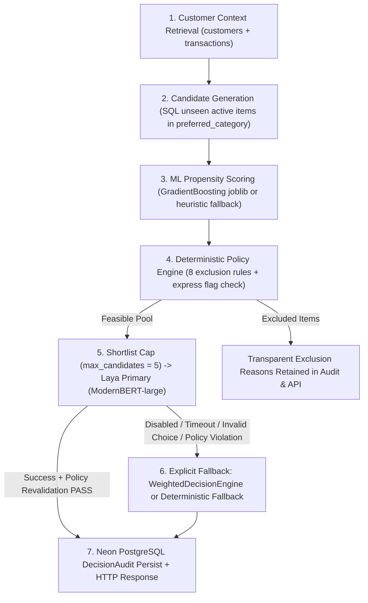
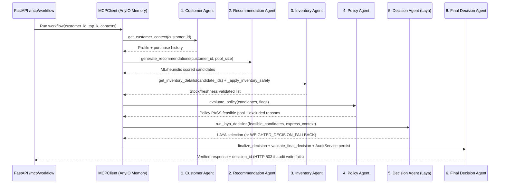
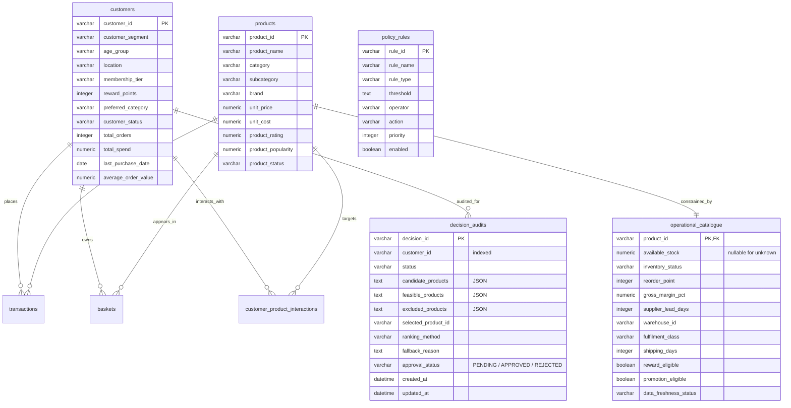

# Complete Technical Audit & Documentation Extraction Report
**Project:** Next-Best-Offer and Product Recommendation with Supply Constraints  
**Repository:** `https://github.com/Ridhimaaaa29/Next-Best-Offer-and-Product-Recommendation-with-Supply-Constraints`  
**Audited Git Commit:** `6373f0d` on `main` (synchronized with `origin/main`)  
**Audit Mode:** Strictly Read-Only Code, Data, Schema, Config & Report Inspection (Zero code/config/DB/deployment changes)

---

## Evidence Label Legend
- `[VERIFIED FROM SOURCE]` — Directly verified in tracked repository source files, model artifacts, datasets, Dockerfiles, or migration scripts.
- `[VERIFIED BY EXECUTION]` — Directly verified by executing read-only tests/inspections in the local workspace virtual environment during this audit.
- `[RECORDED PROJECT CONTEXT]` — Supplied in recorded project runbooks/notes (e.g., AWS EC2/Nginx setup, full 170-test run, live `CUST_0001` AWS runtime responses) but not independently re-executed on live AWS/Neon inside the network-isolated sandbox.
- `[REQUIRES AUTHOR CONFIRMATION]` — External cloud console state, live UI verification, billing, or credentials/permissions that cannot be proven from local repository files alone.
- `[NOT FOUND]` — Searched across the repository and confirmed absent from version-controlled files.

---

## 1. Executive Summary
The **Next-Best-Offer and Product Recommendation with Supply Constraints** system is an enterprise-style constraint-aware e-commerce recommendation and decision platform built with **FastAPI**, **Streamlit**, **Scikit-learn (`GradientBoostingClassifier`)**, **Laya (`laya==0.4.26` / `ModernBERT-large`)**, **Model Context Protocol (MCP)** over in-memory AnyIO streams, **Neon PostgreSQL (SQLAlchemy + Alembic)**, and the **Groq API (`openai/gpt-oss-120b`)** `[VERIFIED FROM SOURCE]`.

Instead of recommending items solely on predicted purchase propensity, the backend separates **customer propensity scoring** from **deterministic operational/business-policy validation** (`policy_engine.py`) and routes only verified feasible candidates (`max_candidates=5`) into **Laya** (`LayaAdapter` singleton), with an explicit multi-objective **Weighted Decision Engine** (`WeightedDecisionEngine`) retained strictly as a labeled fallback (`decision_method="WEIGHTED_DECISION_FALLBACK"`, `fallback_used=True`) `[VERIFIED FROM SOURCE]`.

### Key Audit Highlights
1. **All major "To be completed by the author" technical sections in the draft `NBO_Project_Report.docx` are fully recoverable from source code & data:** Data provenance (§4.3), ML features/splits/hyperparameters/thresholds (§5.4), full policy constraint rules (§6.3), weighted fallback telemetry labels & fallback tests (§7.3), complete 8-table PostgreSQL/Neon ER schema (§10), full 10-page Streamlit UI map (§11), and resolved engineering issues (§15) are extracted in this audit `[VERIFIED FROM SOURCE]`.
2. **Several factual & structural errors in `NBO_Project_Report.docx` and stale `docs/*.md` files were detected:** Most notably, the draft inverts the Candidate Generation vs. ML Propensity Scoring order, omits 6 API routes (`PATCH /approval` and root aliases), under-counts policy rules, falsely asserts no fallback tests exist, describes Docker ports `8000`/`8501` as localhost-bound despite `0.0.0.0` host port bindings in `docker-compose.aws.yml`, and retains stale university phrasing in References `[VERIFIED FROM SOURCE]`.
3. **Repository vs. Cloud Split:** AWS container build/compose files (`Dockerfile.aws`, `docker-compose.aws.yml`, `backend/requirements-aws.txt`, `.env.aws.example`) are committed in git, whereas EC2 console specs, Nginx reverse-proxy config, Security Group rules, and live AWS cost sheets are `[NOT FOUND]` in the repository and rely on `[RECORDED PROJECT CONTEXT]` / `[REQUIRES AUTHOR CONFIRMATION]`.

---

## 2. Review of Draft Project Report (`NBO_Project_Report.docx`): Incorrect, Stale & Missing Items

### 2.1 Incorrect or Inaccurate Statements in the Draft Report
| Draft Location | What the Draft Currently Says | Verified Correction from Source / Execution | Status |
|---|---|---|---|
| **§3.2 (Steps 4–5) & §6.2 (Table 6.1, Stages 2–3)** | Lists `2. ML propensity scoring` **before** `3. Candidate generation` ("generated using the propensity scores"). | **Order is inverted.** `CandidateGenerator` (`backend/app/recommendation/candidate_generator.py`) first filters unseen `active` items matching `preferred_category` via SQL, and **then** `RecommendationModel.rank_candidates` scores those candidates with the Gradient Boosting model (or heuristic fallback). Policy filtering (`policy_engine.py`) and Laya selection follow scoring. | `[VERIFIED FROM SOURCE]` |
| **§6.3 (Constraint Rules)** | Marks margin rule `"negative-margin (margin < 10%)"` as ambiguous and omits full ruleset (`To be completed by the author`). | **Not ambiguous in code:** `backend/app/recommendation/policy_engine.py:150` checks `if gross_margin_pct < 0.10:` (`RULE_MAR_001`, strict 10% minimum margin floor, hardcoded). Full ruleset enforces **8 hard/contextual exclusion rules + 1 warning-only flag rule** (`RULE_STATUS_001`, `RULE_STK_001`, `RULE_STK_002`, `RULE_FRESH_001`, `RULE_MAR_001`, `RULE_REW_001`, `RULE_PRO_001`, `RULE_DSC_001`, plus flag-only `RULE_FUL_001`). Customer dormancy (`customer_status="dormant"`) is **not** filtered by `policy_engine.py`. | `[VERIFIED FROM SOURCE]` |
| **§7.3 (Table 7.1 & Note)** | Has `[Label to be confirmed from the code]` and states `"no recorded fallback-activation test result was supplied"`. | **Both wrong/outdated.** Exact labels in `decision_module.py` & `mcp/workflow.py` are `decision_method="WEIGHTED_DECISION_FALLBACK"` (or `"DETERMINISTIC_FALLBACK"` if disabled), `decision_engine_status="FALLBACK"`, `laya_status="FALLBACK"` or `"UNAVAILABLE"`, `fallback_used=True`. **Multiple automated fallback tests exist and pass** (`test_decision_module.py`, `test_laya_integration.py`, `test_weighted_engine.py`, `test_audit.py`, `test_mcp_workflow.py`, `test_mcp_tools.py`). | `[VERIFIED FROM SOURCE]` / `[VERIFIED BY EXECUTION]` |
| **§12.4 (Line 624), §14, Appendix A** | States `"Both application services are bound to localhost on the EC2 instance"` (`8501 (localhost binding)`, `8000 (localhost binding)`). | **Misleading vs `docker-compose.aws.yml`.** `docker-compose.aws.yml:28-29,71-72` binds `"8000:8000"` and `"8501:8501"` (`0.0.0.0`, all interfaces), NOT `127.0.0.1:8000:8000`. Public exposure is prevented only by the AWS Security Group (blocking TCP 8000/8501 externally) unless modified locally on EC2. | `[VERIFIED FROM SOURCE]` |
| **§12.2 (Table 12.1)** | Reports Instance ID `i-0e863f626a4693fc`. | `0e863f626a4693fc` contains **16** hex characters after `i-`; modern AWS EC2 17-character instance IDs have **17** hex characters. Likely 1 missing hex digit during transcription; verify directly in the EC2 Console. | `[REQUIRES AUTHOR CONFIRMATION]` |
| **§11.1 & §16.1** | States `"Some frontend pages also have CSV fallback behaviour"` vaguely and treats all frontend validation as unverified. | After commit `e8ed41e`, recommendation, MCP workflow, manual audit submit, decision history, and Groq chat functions in `frontend/app.py` have **NO CSV fallback**. Only **4 read-only loaders** (`load_all_customers`, `load_customer_detail`, `load_catalogue`, `load_evaluation_report`) fall back to `data/synthetic/*.csv` and `reports/day3_evaluation_results.csv`, while `load_basket_associations()` always reads local CSVs directly. Also, automated 10-page Streamlit `AppTest` verification passes offline (`36` frontend tests in `task-4497`), though live human browser QA remains pending. | `[VERIFIED FROM SOURCE]` / `[VERIFIED BY EXECUTION]` |
| **Appendix C.1** | Shows fictional root `next_best_offer/` and only `Dockerfile` (Render backup), omitting AWS files, `alembic/`, `models/`, `reports/`, `backend/app/mcp/`, `guardrails/`, `middleware/`, `security/`. | Outdated pre-AWS directory snapshot; see Section 4 below for actual HEAD `6373f0d` tree. | `[VERIFIED FROM SOURCE]` |
| **References (End of docx)** | Includes `"in the citation style required by your institution"`. | Conflicts with independent professional report format (not an academic/institutional submission); should be removed. | `[VERIFIED FROM SOURCE]` |

### 2.2 Missing Information in the Draft Report (Solvable from Repository vs. Author-Required)
| Draft Section | Missing in Draft | Extractable Here? | Section in This Audit |
|---|---|---|---|
| **§1.5 Streamlit URL relationship** | Relationship between `https://nbo-recommendation-engine.streamlit.app/` and `http://13.239.32.129` | **Partial** (`a57698f` + `bc57ea7` show early Streamlit Cloud setup; live binding needs confirmation) | §14.3 |
| **§4.1 & §10 Database Schema / ER Diagram** | Missing all 8 PostgreSQL tables, FKs, PKs, indexes, JSON-serialized audit fields, Alembic revisions | **Yes (100% solved)** | §12 |
| **§4.3 Data Source & Provenance** | Missing raw vs. synthetic datasets, counts (`500` customers, `52` products, `7,466` txn rows, `4,151` interactions), `seed=42`, synthetic constraint injection, `Y=1` target definition | **Yes (100% solved)** | §6 |
| **§5.4 ML Training Details** | Missing 14 numerical + 3 categorical features, temporal cutoffs, 3-model CV table, confusion matrices, Brier/Log-Loss, Day-3 `@5`/`@10` benchmark, threshold `0.2522` | **Yes (100% solved)** | §7 |
| **§6.3 Full Policy Rules** | Missing exact 8 exclusion + 1 express-warning rules (`RULE_*`) and `0.10` threshold | **Yes (100% solved)** | §8 |
| **§7.3 Weighted Fallback Specs** | Missing multi-objective formula `0.45*R + 0.25*M + 0.15*D - 0.15*F`, telemetry labels, and fallback test evidence | **Yes (100% solved)** | §9 |
| **§9 & Appendix B API Endpoints** | Missing `PATCH /api/v1/decisions/history/{decision_id}/approval`, root aliases (`/health`, `/mcp/workflow`, `/assistant/status`, `/assistant/chat`), `HTTP 503` fail-closed audit guard, Pydantic `extra="forbid"`, `MCPServer`'s 12 tools vs 6 required workflow tools | **Yes (100% solved)** | §10 & §11 |
| **§11 Frontend Pages** | Does not name any of the **10 Streamlit pages**, widgets, simulated dispatch notice, or approval UI | **Yes (100% solved)** | §13 |
| **§14 Security & Guardrails** | Misses Groq prompt-injection defense & credential scrubbing (`_sanitize_context`), `mask_connection_string`, MCP error sanitization | **Yes (100% solved)** | §15 |
| **§15 Development Issues** | Completely blank template | **Partial** (local log + AWS Docker/Laya fixes extracted; live EC2 screenshots need author) | §17 |
| **§12.5 Nginx Config, SG Console, EBS Encryption, Appendix D Costing, Screenshots** | Absent from git repository | **No** (`[NOT FOUND]` / `[REQUIRES AUTHOR CONFIRMATION]`) | §14, §19, Author Section |

### 2.3 Stale Internal Repository Docs Flagged During Audit
- **`docs/architecture.md`, `docs/evaluation_report.md`, `docs/known_limitations.md`, `docs/synthetic_data_plan.md`:** Several earlier design docs predate the final Stage B/C builds (`300 customers / 6,211 transactions` in `docs/synthetic_data_plan.md` vs. actual `500 / 7,466`; `HistGradientBoostingClassifier` and `ROC-AUC 0.7470` in `docs/evaluation_report.md` vs. actual `GradientBoostingClassifier`, `ROC-AUC 0.8583`, `PR-AUC 0.7094` in `reports/ml_model_evaluation.md`; `PROD_0036` headphone name vs. `PROD_0036 1080p Webcam` / `PROD_0043` low margin). Authoritative runtime truth resides in source code, `data/synthetic/*.csv`, `models/nbo_propensity_best_model.joblib`, and `reports/ml_model_evaluation.md` `[VERIFIED FROM SOURCE]`.

---

## 3. Project Scope, Objectives & Architecture Evolution

1. **Stage A — Exploratory Clean Retail Baseline (Legacy):** `scripts/prepare_data.py` cleaned Kaggle/UCI `Online Retail II` (`data/raw/online_retail_II.xlsx`, `1,067,371` raw rows -> `766,382` clean rows) into `data/processed/*.csv.gz` and `data/nbo_database.sqlite` (`180,146,176` bytes). Because real-world public retail logs lack stock, gross margin, lead times, and reward/promotion rules, SQLite runtime usage was deprecated (`backend/app/features/feature_engine.py:1-6`) `[VERIFIED FROM SOURCE]`.
2. **Stage B — Constraint-Aware Synthetic Ecosystem & Cloud Postgres (Neon):** `scripts/generate_synthetic_ecosystem.py` (`seed=42`) synthesized a relational retail ecosystem with intentional edge-case supply constraints loaded into **Neon PostgreSQL** via `scripts/schema.sql` and `scripts/load_synthetic_data.py` `[VERIFIED FROM SOURCE]`.
3. **Stage C — ML Propensity, Dual-Engine Decision Layer, Six-Agent MCP, Governance & Deployment:** Trained `GradientBoostingClassifier` (`scripts/evaluate_ml_experiments.py`), implemented deterministic `policy_engine.py`, integrated `convaiinnovations/laya==0.4.26` (`ModernBERT-large`) alongside `WeightedDecisionEngine` fallback, built the 6-stage in-memory MCP workflow (`backend/app/mcp/`), added `decision_audits` Alembic migration & approval governance, built the 10-page Streamlit UI + Groq assistant, and split containerization into Render backup (`Dockerfile`) vs. AWS full Laya stack (`Dockerfile.aws` + `docker-compose.aws.yml`) `[VERIFIED FROM SOURCE]`.

---

## 4. Repository Structure & File Inventory (`HEAD 6373f0d`)

```text
Next-Best-Offer-and-Product-Recommendation-with-Supply-Constraints/
|-- .devcontainer/devcontainer.json         # Streamlit Cloud / Codespace devcontainer
|-- .env.aws.example                        # AWS environment variable template (clean)
|-- .env.example                            # Local environment variable template
|-- .gitignore                              # Excludes .env, .venv, .laya-cache, logs
|-- Dockerfile                              # Render backup image (lightweight, port 10000, torch 2.5.1 CPU)
|-- Dockerfile.aws                          # Full AWS image (python:3.11-slim, Laya + CPU torch + Streamlit)
|-- Dockerfile.aws.dockerignore             # AWS Docker build exclusion rules
|-- docker-compose.yml                      # Local/generic compose
|-- docker-compose.aws.yml                  # AWS stack: nbo-backend-aws (8000) + nbo-frontend-aws (8501) + nbo_laya_cache
|-- Makefile                                # Developer task shortcuts
|-- pytest.ini                              # Pytest configuration
|-- requirements.txt                        # Root requirements (includes streamlit/requests per commit a57698f)
|-- alembic/
|   |-- env.py & alembic.ini
|   `-- versions/
|       |-- a6b5d27525c3_baseline.py
|       `-- c1d9a8f4e3b2_create_decision_audits_table.py
|-- backend/
|   |-- requirements.txt                    # Render/base backend dependencies
|   |-- requirements-aws.txt                # AWS pinned backend + frontend + Laya + torch>=2.2.0 CPU deps
|   |-- documents/engineering/challenge_resolution_log.md
|   `-- app/
|       |-- main.py                         # FastAPI app, lifespan Laya warmup, middleware, router mounting
|       |-- config.py                       # Pydantic BaseSettings (`Settings`) with secret masking
|       |-- logging_config.py               # Logger wrapper
|       |-- api/
|       |   |-- routes/                     # health, recommendations, customers, catalogue, products,
|       |   |                               # decisions, audit, mcp, evaluation, assistant
|       |   |-- schemas/                    # common, recommendation, product
|       |   `-- v1/routers/recommend.py     # UNMOUNTED legacy duplicate router (technical debt)
|       |-- agents/                         # explanation.py, workflow.py (NotImplementedError stubs)
|       |-- db/                             # session.py, models.py (8 ORM models), repositories.py
|       |-- decision/                       # laya_adapter.py, weighted_engine.py, objectives.py,
|       |                                   # baseline_ranker.py, constraints.py, evaluator.py,
|       |                                   # validator.py, models.py, openjev_adapter.py (stub)
|       |-- domain/                         # margin.py, eligibility.py/fulfilment.py/inventory.py (stubs),
|       |                                   # feasibility.py (stub)
|       |-- features/                       # feature_engine.py, customer_features.py, product_features.py, baskets.py
|       |-- guardrails/                     # input_validation.py, output_validation.py
|       |-- mcp/                            # schemas.py, server.py (12 tools), client.py (AnyIO), workflow.py (6 agents)
|       |-- middleware/                     # error_handler.py, request_id.py
|       |-- ml/                             # dataset_builder.py, trainer.py
|       |-- observability/                  # logging.py, metrics.py
|       |-- recommendation/                 # candidate_generator.py, customer_context.py, feasible_candidates.py,
|       |                                   # policy_engine.py, recommendation_model.py, decision_module.py,
|       |                                   # popularity.py, ranker.py, {association_rules,collaborative_filtering,content_based}.py (stubs)
|       |-- security/                       # configuration.py (mask_connection_string)
|       `-- services/                       # audit_service.py, recommendation_service.py (stub)
|-- data/
|   |-- nbo_database.sqlite                 # Legacy SQLite DB (180,146,176 B)
|   |-- processed/                          # cleaned_transactions.csv.gz, baskets.csv.gz, customer_interactions.csv.gz, data_cleaning_audit.csv
|   |-- raw/                                # Online Retail II, Online Retail, All_Beauty, DataCo, Olist (reference archives)
|   `-- synthetic/                          # Authoritative MVP CSVs loaded to Neon (customers, products, operational_catalogue, transactions, baskets, interactions, policy_rules)
|-- docs/                                   # Early specification docs (several pre-Stage-C metrics/counts)
|-- frontend/
|   |-- requirements.txt                    # Frontend-only deps
|   `-- app.py                              # 10-page Streamlit UI (2,107 lines)
|-- models/
|   `-- nbo_propensity_best_model.joblib    # Trained Scikit-learn GradientBoosting pipeline (248,761 B)
|-- notebooks/                              # Generated Jupyter exploratory/evaluation notebooks
|-- reports/                                # ml_model_evaluation.md, day3_model_evaluation.md, *.csv benchmarks
|-- scripts/                                # prepare_data.py, generate_synthetic_ecosystem.py, schema.sql,
|                                           # load_synthetic_data.py, evaluate_ml_experiments.py, evaluate_day3_model.py,
|                                           # create_notebooks.py, use-f-drive.ps1
`-- tests/                                  # 22 files across api/, decision/, evaluation/, integration/, unit/
```
`[VERIFIED FROM SOURCE]` (Note: `backend/requirements-render.txt` exists locally as an untracked file and is excluded from commit `6373f0d`.)

---

## 5. Technology Stack & Verified Package Versions (`backend/requirements-aws.txt`)

| Layer | Technology / Package | Exact Version / Spec | Source |
|---|---|---|---|
| Python Runtime (Docker / Local) | Python | `python:3.11-slim` (AWS/Render Docker) / `3.14.6` (local `.venv`) | `Dockerfile.aws:4`, `task-4474.log` `[VERIFIED FROM SOURCE]` / `[VERIFIED BY EXECUTION]` |
| Web API Framework | `fastapi` + `uvicorn[standard]` | `fastapi==0.162.0`, `uvicorn[standard]==0.54.0` | `backend/requirements-aws.txt:8-9` `[VERIFIED FROM SOURCE]` |
| Validation & Config | `pydantic`, `pydantic-settings`, `python-dotenv` | `2.13.4`, `2.16.2`, `1.2.3` | `backend/requirements-aws.txt:10-11,16` `[VERIFIED FROM SOURCE]` |
| Database & Migrations | `sqlalchemy`, `alembic`, `psycopg[binary]` | `2.1.6`, `1.20.1`, `3.3.6` | `backend/requirements-aws.txt:12-14` `[VERIFIED FROM SOURCE]` |
| Logging & HTTP Client | `structlog`, `httpx`, `requests` | `26.1.0`, `0.28.1`, `>=2.28.0` | `backend/requirements-aws.txt:15,17,29` `[VERIFIED FROM SOURCE]` |
| Machine Learning | `scikit-learn`, `joblib`, `numpy`, `pandas` | `1.9.1`, `1.5.3`, `>=1.26.0`, `>=2.0.0` | `backend/requirements-aws.txt:18-21` `[VERIFIED FROM SOURCE]` |
| Primary Decision Engine | `laya` + `torch` (CPU index) + `transformers`, `safetensors`, `huggingface_hub` | `laya==0.4.26`, `torch>=2.2.0` (`--index-url https://download.pytorch.org/whl/cpu`), `transformers>=4.48.0`, `safetensors>=0.4.0`, `huggingface_hub>=0.26.0` | `Dockerfile.aws:15`, `backend/requirements-aws.txt:6,23-27` `[VERIFIED FROM SOURCE]` |
| Laya Checkpoint Internals | `convaiinnovations/laya` snapshot `7b928d8...` | Base encoder `answerdotai/ModernBERT-large` (`ModernBertForMaskedLM`, `hidden_size=1024`, `intermediate_size=2624`), `model.safetensors` (`842,609,210` B), `tokenizer.json` (`3,583,228` B, `model_max_length=8192`), `head_layers=2`, `max_len=512`, `head_max_len=192`, `max_prefixes=6`, `encoder/config.json` `dtype="float32"`, CPU FP32 runtime default (`laya_cpu_bfloat16=False`) | `.laya-cache/`, `config.py:74`, `laya_adapter.py:280-290` `[VERIFIED FROM SOURCE]` |
| Multi-Agent Protocol | `mcp` (with `anyio` memory streams) | `mcp==2.3.0` (`anyio==4.16.0` observed in `.venv`) | `backend/requirements-aws.txt:22`, `task-4474.log` |
| Frontend UI | `streamlit` | `>=1.30.0` | `backend/requirements-aws.txt:28` `[VERIFIED FROM SOURCE]` |
| Assistant LLM | Groq OpenAI-compatible REST API | Default model `openai/gpt-oss-120b` (`https://api.groq.com/openai/v1/chat/completions`) | `backend/app/config.py:62-63`, `assistant.py` `[VERIFIED FROM SOURCE]` |

---

## 6. Data Engineering, Datasets & Provenance (Completes Draft §4.3)

### 6.1 Authoritative Synthetic MVP Ecosystem (`data/synthetic/`, Seed = `42`)
Generated by `scripts/generate_synthetic_ecosystem.py` (`seed=42`) and loaded into Neon PostgreSQL via `scripts/load_synthetic_data.py` `[VERIFIED FROM SOURCE]`:

| File / Table | Size (Bytes) | Rows | Columns | Missing Values | Verified Distributions & Characteristics |
|---|---:|---:|---:|---:|---|
| `customers.csv` | 62,355 | 500 | 12 | 0 | Segments: `Health & Wellness Regular` (130), `Casual Budget Shopper` (128), `Tech & Gadget Aficionado` (123), `High-Value Enthusiast` (68), `Occasional Gifter` (51). Tiers: `Bronze` (227), `Silver` (150), `Gold` (74), `Platinum` (49). Status: `active` (469), `dormant` (31). Preferred categories: `Electronics` (171), `Health & Fitness` (130), `Beauty & Skincare` (75), `Home & Living` (72), `Coffee & Kitchen` (52). |
| `products.csv` | 5,907 | 52 | 10 | 0 | Categories: `Electronics` (13), `Coffee & Kitchen` (13), `Health & Fitness` (10), `Home & Living` (8), `Beauty & Skincare` (8). Status: `active` (51), `discontinued` (1: `PROD_0044`). Prices `$8.99`–`$1,899.99`. |
| `operational_catalogue.csv` | 8,728 | 52 | 18 | 1 (`available_stock` NULL for `PROD_0003`) | Inventory: `available` (47), `out_of_stock` (3: `PROD_0002`, `PROD_0013`, `PROD_0037`), `unknown` (1: `PROD_0003`), `low_stock` (1: `PROD_0004`, stock=`3.0`). Freshness: `verified_fresh` (52). Margin range `0.05`–`0.80`; `< 0.10` violations: `PROD_0036` & `PROD_0043` (`0.05`). Shipping `> 7d`: `PROD_0038` (`10` days). `reward_eligible=False`: `PROD_0007`, `PROD_0037`. `promotion_eligible=False`: `PROD_0037`. |
| `transactions.csv` | 691,704 | 7,466 | 10 | 0 | `3,655` unique `transaction_id` orders from `2025-01-01 09:16:00` to `2026-10-24 21:08:00`; `completed` (7,261), `returned` (205). |
| `baskets.csv` | 336,028 | 7,466 | 5 | 0 | `3,655` unique `basket_id` multi-item market baskets aligned with transactions. |
| `customer_product_interactions.csv` | 245,998 | 4,151 | 9 | 0 | Historical customer-product pairs across all `500` customers and all `52` products with `interaction_count`, `recency_score`, `category_preference_score`. |
| `policy_rules.csv` | 1,304 | 7 | 9 | 0 | `RULE_STK_001`, `RULE_STK_002`, `RULE_MAR_001`, `RULE_REW_001`, `RULE_FUL_001`, `RULE_PRO_001`, `RULE_STATUS_001`. |

**Synthetic vs. Real Labeling:** The entire Neon runtime MVP dataset is **synthetically generated** (`generate_synthetic_ecosystem.py`, `seed=42`) so operational constraints (`available_stock`, `gross_margin_pct`, `supplier_lead_days`, `shipping_days`, `reward_eligible`, `promotion_eligible`, `data_freshness_status`) exist deterministically alongside transactions `[VERIFIED FROM SOURCE]`.

### 6.2 Reference Raw Datasets & Legacy Cleaned Artifacts (Offline Exploration Only)
- **Legacy Cleaned Pipeline (`scripts/prepare_data.py`, `data/processed/data_cleaning_audit.csv`):** Cleaned `data/raw/online_retail_II.xlsx` (`45,622,278` B) from `1,067,371` raw rows down to `766,382` clean rows (`5,862` customers, `4,625` products, `36,645` baskets) stored in `data/processed/*.csv.gz` (`cleaned_transactions.csv.gz` `13,301,113` B; `customer_interactions.csv.gz` `3,910,269` B; `baskets.csv.gz` `2,042,954` B) and legacy `data/nbo_database.sqlite` (`180,146,176` B) `[VERIFIED FROM SOURCE]`.
- **Unconsumed Raw Benchmark Archives (`data/raw/`):** `All_Beauty.jsonl` (`326,611,506` B), `meta_All_Beauty.jsonl` (`212,990,142` B), `DataCoSupplyChainDataset.csv` (`95,910,149` B, `180,519` rows), `olist_customers_dataset.csv` (`9,033,957` B, `99,441` rows), `Online Retail.xlsx` (`23,715,344` B) `[VERIFIED FROM SOURCE]`.

---

## 7. Machine Learning Propensity Pipeline (Completes Draft §5.4)

### 7.1 Target Definition, Temporal Splitting & Leakage Prevention (`backend/app/ml/dataset_builder.py`)
- **Positive Class (`Y = 1`):** Customer purchased the candidate product during the target observation window (`completed` / transaction record in window); **`Y = 0`**: non-purchased customer–product negative pair sampled at a fixed **`3:1` negative-to-positive ratio** (`seed=42`) `[VERIFIED FROM SOURCE]`.
- **Strict Temporal Leakage Control:**
  - **Development / CV Set:** Historical features computed strictly `< 2026-01-01`; targets observed `2026-01-01` to `2026-05-31` -> **`5,832` rows** (`1,458` positive / `4,374` negative) `[VERIFIED FROM SOURCE]`.
  - **Untouched Holdout Test Set:** Historical features computed strictly `< 2026-06-01`; targets observed `2026-06-01` to `2026-10-24` -> **`5,524` rows** (`1,381` positive / `4,143` negative) `[VERIFIED FROM SOURCE]`.

### 7.2 Feature Schema (17 Input Features in `PropensityTrainer` & `.joblib` Artifact)
- **14 Numerical Features (`StandardScaler`):** `reward_points`, `hist_total_orders`, `hist_total_spend`, `hist_aov`, `unit_price`, `unit_cost`, `product_rating`, `product_popularity`, `hist_product_popularity`, `hist_interaction_count`, `hist_total_quantity`, `hist_total_spend_interaction`, `hist_recency_days`, `is_preferred_category` `[VERIFIED FROM SOURCE]`.
- **3 Categorical Features (`OneHotEncoder(handle_unknown="ignore", sparse_output=False)`):** `membership_tier`, `category`, `subcategory` `[VERIFIED FROM SOURCE]`.

### 7.3 Model Selection & Recorded Evaluation Metrics (`reports/ml_model_evaluation.md`)
Evaluated with **5-Fold Stratified Cross-Validation** (`StratifiedKFold(n_splits=5, shuffle=True, random_state=42)`) and `GridSearchCV(scoring="average_precision")` (`backend/app/ml/trainer.py`):

| Model Family | Best Tuned Hyperparameters | 5-Fold CV PR-AUC | Status |
|---|---|---:|---|
| Logistic Regression | `C=10.0, penalty='l2', solver='lbfgs'` | 0.7399 | Baseline |
| Random Forest Classifier | `max_depth=8, min_samples_split=2, n_estimators=50` | 0.7437 | Candidate |
| **Gradient Boosting Classifier** | `learning_rate=0.05, max_depth=5, n_estimators=50, random_state=42` | **0.7467** (`0.746661`) | **Selected (`models/nbo_propensity_best_model.joblib`, `248,761` B)** |

- **Optimal F1 Classification Threshold:** `τ* = 0.2522` (`0.25221008`) `[VERIFIED FROM SOURCE]`.
- **Untouched Holdout Set (`5,524` pairs):**
  - Threshold-independent metrics: **ROC-AUC = `0.8583`**, **PR-AUC = `0.7094`**, **Brier Score = `0.1143`**, **Log-Loss = `0.3726`**.
  - At `τ = 0.50`: Accuracy `0.8436`, Precision `0.7502`, Recall `0.5612`, F1 `0.6421` (`TN=3885, FP=258, FN=606, TP=775`).
  - At `τ* = 0.2522`: Accuracy `0.8244`, Precision `0.6160`, Recall `0.7900`, F1 `0.6923` (`TN=3463, FP=680, FN=290, TP=1091`).
- **Downstream Ranking Benchmark (`reports/ml_model_evaluation.md`, `reports/day3_evaluation_results.csv`):**
  - `@5` Day-3 ML Propensity: Precision@5 `0.1547`, Recall@5 `0.1967`, HitRate@5 `0.5000`, Coverage@5 `0.8654`, Policy Compliance `1.0`, Infeasible Recs `0` (vs. Popularity Baseline: Precision@5 `0.0464`, HitRate@5 `0.163`, Coverage `0.2308`).
  - `@10` Day-3 ML Propensity: Precision@10 `0.0856`, Recall@10 `0.2170`, HitRate@10 `0.5083`, Coverage@10 `0.8654`, Policy Compliance `1.0`, Infeasible Recs `0` (vs. Popularity Baseline Compliance `0.982`, `65` infeasible items leaked) `[VERIFIED FROM SOURCE]`.

---

## 8. Recommendation Pipeline & Deterministic Policy Engine (`policy_engine.py`)

### 8.1 Corrected End-to-End Execution Order

`[VERIFIED FROM SOURCE]`

- If `.joblib` artifact loading or feature extraction fails, `RecommendationModel` (`backend/app/recommendation/recommendation_model.py`) degrades cleanly to a deterministic linear heuristic score combining category preference, popularity, rating, and normalized recency `[VERIFIED FROM SOURCE]`.

### 8.2 Full Business-Policy Rules (`backend/app/recommendation/policy_engine.py:116-193`)

| Rule ID | Condition Checked | Threshold / Logic | Action | Fail-Safe / Nuance |
|---|---|---|---|---|
| `RULE_STATUS_001` | `product_status != "active"` | Exact lowercase match `"active"` | **EXCLUDE** | Discontinued items (e.g., `PROD_0044`) blocked |
| `RULE_STK_001` | `available_stock <= 0` | Strict numeric `<= 0` | **EXCLUDE** | Out-of-stock items (`PROD_0002`, `PROD_0013`, `PROD_0037`) blocked |
| `RULE_STK_002` | `available_stock is None` or `inventory_status == "unknown"` | Fail-closed unknown guard | **EXCLUDE** | Missing stock (`PROD_0003`) never assumed in-stock |
| `RULE_FRESH_001` | `data_freshness_status not in {"verified_fresh", "fresh"}` | Fail-closed freshness guard | **EXCLUDE** | Unverified/stale snapshots blocked |
| `RULE_MAR_001` | `gross_margin_pct < 0.10` | Strict **`< 0.10` (10% minimum floor)** | **EXCLUDE** | Hardcoded (not `< 0%` and not env-configurable); blocks `PROD_0036` & `PROD_0043` (`0.05`) |
| `RULE_REW_001` | `reward_context and not reward_eligible` | Contextual boolean gate | **EXCLUDE** | Blocks e.g. `PROD_0007` when `reward_context=True` |
| `RULE_PRO_001` | `promotion_context and not promotion_eligible` | Contextual boolean gate | **EXCLUDE** | Blocks `PROD_0037` when promotional offer requested |
| `RULE_DSC_001` | `requested_discount_pct > max_discount_pct` | Guardrail cap | **EXCLUDE** | Blocks excess discount requests |
| `RULE_FUL_001` | `express_context and shipping_days > 7` | Soft operational warning | **FLAG ONLY** | Appends warning to `flags`; does **not** exclude candidate (`PROD_0038` `10d`) |
`[VERIFIED FROM SOURCE]`

**Note on Customer Eligibility:** `policy_engine.py` does not reject customers whose `customer_status` is `"dormant"`; dormant/inactive customer filtering is not enforced at policy level `[VERIFIED FROM SOURCE]`.

---

## 9. Laya Primary Decision Engine & Weighted Decision Fallback

### 9.1 `LayaAdapter` Singleton & CPU Inference (`backend/app/decision/laya_adapter.py`)
- **Process Singleton:** Class-level `_cached_router` protected by `threading.Lock()`, shared across FastAPI REST endpoints and in-memory AnyIO MCP sessions (`MCPClient(transport="memory")`) `[VERIFIED FROM SOURCE]`.
- **Startup Warmup vs. Lazy Init:** Controlled by `LAYA_PRELOAD_ON_STARTUP` (`true` in `Dockerfile.aws` / `docker-compose.aws.yml`; `false` default in `Settings`). `GET /api/v1/health` and `GET /api/v1/laya/status` inspect `LayaAdapter().status_info()` using `importlib.util.find_spec("laya")` **without loading model weights** `[VERIFIED FROM SOURCE]`.
- **Offline Cache & Memory Safeguards:** Sets `HF_HOME` to `LAYA_CACHE_DIR` (`/app/.laya-cache` in Docker) and auto-enables `HF_HUB_OFFLINE=1` when `model.safetensors` exists locally; sets `max_loaded=1`, `preload=False`, `vega=False`, `agent_kwargs={"compile": False, "fast": False}`, enforces `laya_timeout_seconds=45.0`, caps shortlist at `laya_max_candidates=5`, and keeps **CPU FP32** by default (`laya_cpu_bfloat16=False`) with optional silent fallback if `bfloat16` is requested and unsupported `[VERIFIED FROM SOURCE]`.
- **Render Guardrail:** When `APP_ENV` is `production`, `prod`, or `render` without an explicit `LAYA_ENABLED=true` override, `LayaAdapter` disables itself cleanly to stay inside Render's 512 MB RAM ceiling `[VERIFIED FROM SOURCE]`.
- **Hard Invariant Check (`decision_module.py`):** Whatever product Laya selects is validated against `feasible_ids` AND re-run through `evaluate_product()`. If an infeasible or missing candidate is ever returned, `LayaAdapter`/`DecisionModule` rejects it and drops cleanly to fallback; if any selected item ever has `policy_decision != "PASS"`, `DecisionModule.decide()` raises `RuntimeError` `[VERIFIED FROM SOURCE]`.

### 9.2 Weighted Fallback Formula (`backend/app/decision/weighted_engine.py`)
Only executed when Laya is disabled, unavailable, times out, raises an exception, or returns an invalid choice:
$$S_i = w_r R_i + w_m M_i + w_d D_i - w_f F_i$$
Default normalized weights (`Settings`): Relevance `w_r = 0.45`, Margin `w_m = 0.25`, Diversity `w_d = 0.15`, Friction penalty `w_f = 0.15` (`objectives.py`) `[VERIFIED FROM SOURCE]`.

### 9.3 Exact Telemetry Labels Comparison (Fixes Draft §7.3)
| Execution Path | `decision_method` / `ranking_method` | `decision_engine_status` | `laya_status` | `fallback_used` |
|---|---|---|---|---|
| **Laya Primary (Normal)** | `"LAYA"` | `"LAYA_PRIMARY"` | `"SUCCESS"` | `False` |
| **Weighted Fallback** | `"WEIGHTED_DECISION_FALLBACK"` | `"FALLBACK"` | `"FALLBACK"` or `"UNAVAILABLE"` | `True` |
| **Secondary Deterministic Baseline** (if weighted engine also disabled/errors) | `"DETERMINISTIC_FALLBACK"` | `"FALLBACK"` | `"UNAVAILABLE"` / `"FALLBACK"` | `True` |
`[VERIFIED FROM SOURCE]`

---

## 10. MCP Six-Agent Workflow Architecture (`backend/app/mcp/`)

### 10.1 Transport & Tool Registry
- **In-Memory Singleton Sharing (`client.py`):** `MCPClient(transport="memory")` creates AnyIO memory object streams (`create_client_server_memory_streams()`) and runs the server session inside `anyio.create_task_group()` in the same Python process, preventing duplicate ~2 GB+ Laya weight loading (`stdio` subprocess spawn avoided) `[VERIFIED FROM SOURCE]`.
- **Tool Count (`server.py`):** `_REQUIRED_TOOLS` verifies **6 mandatory workflow tools** (`get_customer_context`, `generate_recommendations`, `get_inventory_details`, `evaluate_policy`, `run_laya_decision`, `finalize_decision`), while `@server.tool` actually registers **12 callable MCP tools** including `get_customer_purchase_history`, `get_product_details`, `validate_final_decision`, `run_decision_engine`, `get_evaluation_metrics`, and `save_decision` `[VERIFIED FROM SOURCE]`.

### 10.2 Six Sequential Workflow Stages (`backend/app/mcp/workflow.py`)

`[VERIFIED FROM SOURCE]`

---

## 11. Backend API Reference (`backend/app/main.py` & `api/routes/`)

- **Global Middleware & Exception Handling:**
  - `RequestIdMiddleware` (`middleware/request_id.py`): Propagates or generates UUID `X-Request-ID` header on every request/response.
  - `LoggingMiddleware` & `validation_exception_handler` (`middleware/error_handler.py`): Structured request logging and standardized `HTTP 422` (`HTTP_422_UNPROCESSABLE_CONTENT`) Pydantic validation error responses.
- **Fail-Closed Audit Persistence (`audit_service.py`):** Recommendation and decision endpoints persist a `DecisionAudit` row to Neon PostgreSQL; database write failures raise **`HTTP 503`** rather than returning unaudited decisions.

### Complete Mounted Endpoints (Fixes Draft §9 & Appendix B Omissions)
| Method | Path (`/api/v1` + Root Aliases) | Handler Module | Purpose & Key Notes |
|---|---|---|---|
| `GET` | `/api/v1/health`, **`/health`** (root alias) | `health.py` | DB connectivity, ML artifact load check, non-loading `LayaAdapter.status_info()` (`status="healthy"` or `"degraded"`). |
| `POST` | `/api/v1/recommend` | `recommendations.py` | Full ML + Policy + Laya (or fallback) NBO pipeline + persists `decision_audits` row (`404` missing customer, `503` audit error). |
| `POST` | `/api/v1/mcp/workflow`, **`/mcp/workflow`** (root alias) | `mcp.py` | Executes 6-agent in-memory MCP workflow + sanitizes error messages + persists `decision_audits` row. |
| `GET` | `/api/v1/customers` | `customers.py` | Search customers (`search`, `limit` 1–500). |
| `GET` | `/api/v1/customers/{customer_id}` | `customers.py` | Customer profile, `customer_product_interactions`, last 25 `transactions` (`404` if missing). |
| `GET` | `/api/v1/catalogue` | `catalogue.py` | Lists `products` left-joined with `operational_catalogue` (`inventory_status`, `product_status`, `margin_below`, `limit`). |
| `GET` | `/api/v1/catalogue/{product_id}` | `catalogue.py` | Product + operational detail (`404` if missing). |
| `GET` | `/api/v1/products/{product_id}` | `products.py` | Compatibility operational product alias backed by `_catalogue_payload`. |
| `GET` | `/api/v1/decisions/status` | `decisions.py` | Decision engine & Laya readiness telemetry without loading model weights. |
| `GET` | `/api/v1/laya/status` | `decisions.py` | Explicit Laya readiness/cache/provider telemetry. |
| `POST` | `/api/v1/decisions/evaluate` | `decisions.py` | Evaluates explicit `product_ids` against `policy_engine.evaluate_product` + contextual flags. |
| `POST` | `/api/v1/decisions/optimize` | `decisions.py` | Runs `DecisionModule.decide()` (Laya + fallback) + persists `decision_audits` row. |
| `POST` | `/api/v1/decisions/laya` | `decisions.py` | Direct Laya decision invocation with `WeightedDecisionEngine` fallback + persists `decision_audits` row. |
| `GET` | `/api/v1/decisions/history` | `audit.py` | Queries persisted `decision_audits` ordered newest-first (`customer_id`, `approval_status`, `limit`). |
| `POST` | `/api/v1/decisions/history` | `audit.py` | Creates manual audit record (`AuditService.create_manual_audit`) with `approval_status="PENDING"` (`409` if duplicate `decision_id`). |
| `PATCH` | **`/api/v1/decisions/history/{decision_id}/approval`** | `audit.py` | Updates `approval_status` (`APPROVED`, `REJECTED`, `PENDING`) + `updated_at` timestamp (**missing in draft §9**). |
| `GET` | `/api/v1/evaluation/metrics` | `evaluation.py` | Parses saved `reports/day3_evaluation_results.csv` and `reports/ml_model_evaluation.md`. |
| `GET` | `/api/v1/assistant/status`, **`/assistant/status`** | `assistant.py` | Reports `configured` (whether `GROQ_API_KEY` set) and `model` (`openai/gpt-oss-120b`). |
| `POST` | `/api/v1/assistant/chat`, **`/assistant/chat`** | `assistant.py` | Server-side Groq proxy with prompt-injection/context credential scrubbing (`_sanitize_context`). |
| *(Dead Code)* | `/recommend` in `backend/app/api/v1/routers/recommend.py` | `recommend.py` | Exists on disk but is **never mounted** in `backend/app/main.py`. |
`[VERIFIED FROM SOURCE]`

---

## 12. Database Architecture, Schema & ER Model (Completes Draft §10)

Neon PostgreSQL hosts **8 relational/audit tables** defined in `backend/app/db/models.py:31-167`, `scripts/schema.sql:1-173`, and Alembic migration `alembic/versions/c1d9a8f4e3b2_create_decision_audits_table.py` (`a6b5d27525c3` baseline -> `c1d9a8f4e3b2` audit table) `[VERIFIED FROM SOURCE]`:

1. `customers` (PK `customer_id VARCHAR(50)`)
2. `products` (PK `product_id VARCHAR(50)`)
3. `transactions` (Composite PK `(transaction_id, product_id)`, FK `customer_id -> customers`, FK `product_id -> products`)
4. `baskets` (Composite PK `(basket_id, product_id)`, FK `customer_id -> customers`, FK `product_id -> products`)
5. `customer_product_interactions` (Composite PK `(customer_id, product_id)`, FK `customer_id -> customers`, FK `product_id -> products`)
6. `operational_catalogue` (PK `product_id VARCHAR(50)`, FK `product_id -> products`; nullable `available_stock`)
7. `policy_rules` (PK `rule_id VARCHAR(50)`, `threshold TEXT`)
8. `decision_audits` (PK `decision_id VARCHAR(64)`, indexed `customer_id VARCHAR(50)`, `status`, JSON-serialized `Text` arrays `candidate_products` / `feasible_products` / `excluded_products`, `selected_product_id`, `ranking_method`, `fallback_reason`, `approval_status` default `"PENDING"`, `created_at`, `updated_at`).


`[VERIFIED FROM SOURCE]`

---

## 13. Frontend Streamlit Application Audit (`frontend/app.py` — Fixes Draft §11)

`frontend/app.py` (`2,107` lines) exposes **10 navigation pages** configured via `API_BASE_URL` (default `http://localhost:8000/api/v1`, overridden to `http://backend:8000/api/v1` in `docker-compose.aws.yml`):

1. **Executive Overview** (`_render_executive_overview`): Platform KPIs, backend health badge, Laya engine readiness, and Neon DB indicator.
2. **Customer Intelligence Hub**: Customer lookup, demographics/loyalty metrics, purchase & interaction history (`GET /customers/{id}`).
3. **Recommendations & Discovery**: Context toggles (`reward`, `promotion`, `express`, `top_k`), live NBO recommendation call (`POST /recommend`), ML propensity & objective breakdowns, excluded candidates & reasons, basket associations (`data/synthetic/baskets.csv` read directly).
4. **Customer Preferences Studio**: Live customer attribute overrides, simulated preference exploration, and comparison re-scoring.
5. **Next-Best-Offer & Rewards**: Reward-eligible (`reward_context=True`) & promo-eligible NBO offer framing plus **simulated dispatch notice** (explicitly labeled non-production simulation; no SMS/email provider).
6. **MCP Multi-Agent Workflow**: Interactive trigger for `POST /mcp/workflow` showing all 6 sequential agent traces, Laya primary vs. fallback badge, policy validation, and audit ID.
7. **Inventory & Policy Control**: Filterable operational catalogue table (`GET /catalogue`), highlighting OOS, unknown (`PROD_0003`), low stock (`PROD_0004`), `<10%` margin (`PROD_0036`, `PROD_0043`), slow shipping (`PROD_0038`), and discontinued (`PROD_0044`).
8. **Analytics & Performance Insights**: Renders offline ML & Day-3 `@K` metrics (`GET /evaluation/metrics` with CSV fallback to `reports/day3_evaluation_results.csv`).
9. **Live End-to-End Demo**: Single-screen walkthrough triggering customer load -> recommendation -> policy -> decision audit capture.
10. **AI Decision & Governance Assistant**: **Groq Assistant Q&A** (`GET /assistant/status`, `POST /assistant/chat`) plus **Decision History Governance Table** (`GET /decisions/history`, manual `POST`, and `PATCH /decisions/history/{id}/approval` buttons for Approve/Reject).

**Exact CSV Fallback Scope (Post-`e8ed41e`):** Recommendations, MCP workflow, manual audit creation, decision history, and Groq assistant calls **fail transparently without CSV fallback**. Only `load_all_customers`, `load_customer_detail`, `load_catalogue`, and `load_evaluation_report` retain local CSV fallback; `load_basket_associations()` reads `data/synthetic/{baskets,products}.csv` directly `[VERIFIED FROM SOURCE]`.

---

## 14. Configuration, Containerization & Cloud Deployment (Local / Render / AWS)

### 14.1 Render Backup vs. AWS Full Production Containers
| Attribute | Render Backup (`Dockerfile`) | AWS Full Stack (`Dockerfile.aws` + `docker-compose.aws.yml`) |
|---|---|---|
| Base Image & Port | `python:3.11-slim`, `PORT=10000` | `python:3.11-slim`, backend `8000` + frontend `8501` |
| PyTorch Build | `torch==2.5.1` (`--index-url https://download.pytorch.org/whl/cpu`) | `"torch>=2.2.0"` (`--index-url https://download.pytorch.org/whl/cpu`) |
| Dependencies | `backend/requirements.txt` (lightweight backend) | `backend/requirements-aws.txt` (backend + frontend + `laya==0.4.26`) |
| Laya Mode | Auto-disabled (`APP_ENV=render` -> 512 MB guard; Weighted fallback) | `LAYA_ENABLED=true`, `LAYA_PRELOAD_ON_STARTUP=true`, `--workers 1` |
| Weight Caching | None | Persistent named Docker volume `nbo_laya_cache:/app/.laya-cache` |
| Healthcheck | None in `Dockerfile` | Backend `start_period=180s`; Frontend waits on `service_healthy` |
`[VERIFIED FROM SOURCE]`

### 14.2 AWS EC2 & Networking Status
- **Verified in Repo (`Dockerfile.aws`, `docker-compose.aws.yml`, `.env.aws.example`):** Services `nbo-backend-aws` and `nbo-frontend-aws` share image `nbo-aws-full:latest`; frontend calls backend over Docker bridge `http://backend:8000/api/v1`; Docker `ports:` declare `"8000:8000"` and `"8501:8501"` `[VERIFIED FROM SOURCE]`.
- **Supplied from Runtime Notes (`[RECORDED PROJECT CONTEXT]`):** Region `ap-southeast-2` (Sydney), EC2 `NBO-Laya-Production`, `m7i-flex.large` (`2` vCPU, `8 GiB` RAM, Ubuntu Server `24.04.5 LTS` 64-bit x86), Public IP `13.239.32.129`, Private IP `172.31.2.121`, `30 GiB gp3` (`3000 IOPS`, `125 MiB/s`), Nginx HTTP port `80` -> `127.0.0.1:8501` (with WebSocket headers).
- **Not Found in Repository (`[NOT FOUND]`):** `nginx.conf`, EC2 user-data/provisioning scripts, Security Group IaC/JSON (SSH TCP 22 `/32`, HTTP TCP 80 `0.0.0.0/0`), EBS encryption config, and TLS certificates `[NOT FOUND]`.

### 14.3 Streamlit Community Cloud Relationship (`https://nbo-recommendation-engine.streamlit.app/`)
Commit `a57698f` (2026-11-07) added `streamlit` and `requests` to root `requirements.txt` `"for Streamlit Community Cloud deployment"`, and commit `bc57ea7` (2026-11-10) added `.devcontainer/devcontainer.json` for `streamlit run frontend/app.py`. Because `frontend/app.py:23` reads `API_BASE_URL` strictly from environment variables (defaulting to `http://localhost:8000/api/v1`), Streamlit Community Cloud represented an **earlier cloud frontend host prior to the self-contained AWS EC2 Docker Compose stack (`http://13.239.32.129`)**. Whether Streamlit Cloud is still active/configured to hit an external backend URL `[REQUIRES AUTHOR CONFIRMATION]`.

---

## 15. Security, Guardrails & Privacy Hygiene

1. **Secrets & Credential Protection `[VERIFIED FROM SOURCE]`:**
   - `.gitignore` excludes `.env`; `.env.aws.example` contains placeholder strings only.
   - `Settings.__repr__()` (`config.py`) and `security/configuration.py` (`mask_connection_string`) mask DB credentials in logs; Groq `GROQ_API_KEY` stays strictly server-side in `backend/app/api/routes/assistant.py`.
2. **LLM Prompt-Injection & Output Guardrails `[VERIFIED FROM SOURCE]`:**
   - `assistant.py` defines strict grounded `SYSTEM_PROMPT` instructing Groq never to invent unavailable stock/policies/data and scrubs incoming context keys matching credential patterns via `_sanitize_context()` before forwarding context.
   - `mcp.py:_sanitize_error_message` redacts sensitive internal strings before returning error details.
3. **Input Validation & Fail-Closed Design `[VERIFIED FROM SOURCE]`:**
   - Pydantic v2 `extra="forbid"` rejects unexpected request fields; `policy_engine.py` fails closed on `NULL` stock or unfresh data; `DecisionModule` raises `RuntimeError` if a non-`PASS` recommendation attempts to escape; audit writes fail closed (`HTTP 503`).
4. **Known Security Gaps / Unverified Infrastructure Controls:**
   - No HTTPS/TLS or authentication/RBAC in FastAPI/Streamlit `[VERIFIED FROM SOURCE]`.
   - Security Group `/32` SSH rule, EBS encryption flag, and EC2 `.env` `chmod 600` status `[REQUIRES AUTHOR CONFIRMATION]`.

---

## 16. Testing, Verification & Runtime Evidence

### 16.1 Repository Test Inventory (`tests/` = 22 Files)
- **19 Pytest Files = `170` collected parameterized tests (`148` `def test_*` functions):**
  - **`tests/api/` (`37` tests):** `test_assistant.py` (11), `test_audit.py` (6), `test_mcp_workflow.py` (6), `test_health.py` (2), `test_recommend.py` (6), `test_ml_pipeline.py` (6).
  - **`tests/decision/` (`44` tests):** `test_decision_module.py` (15), `test_laya_integration.py` (6), `test_policy_engine.py` (17), `test_weighted_engine.py` (6).
  - **`tests/unit/` (`89` tests):** `test_candidate_generator.py` (6), `test_customer_context.py` (3), `test_frontend_mcp.py` (7), `test_frontend_preferences_studio.py` (13), `test_frontend_recommendations.py` (16), `test_mcp_tools.py` (8), `test_recommendation_model.py` (5), `test_repositories.py` (25), `test_session_injection.py` (6) — sum = **`170`** parametrized pytest cases across `19` files `[VERIFIED FROM SOURCE]`.
- **3 Standalone Non-Pytest CLI Scripts (`0` pytest functions):** `tests/decision/test_feasible_candidates.py`, `tests/integration/test_neon_connection.py`, `tests/integration/test_relationships.py` `[VERIFIED FROM SOURCE]`.

### 16.2 Current Execution Verification (Inside Network-Blocked Sandbox)
Executed after final commit `6373f0d` on the 9 offline decision/unit/frontend test files (`task-4497`):
- Command: `.\.venv\Scripts\python.exe -m pytest tests/decision/test_weighted_engine.py tests/decision/test_policy_engine.py tests/decision/test_decision_module.py tests/decision/test_laya_integration.py tests/unit/test_mcp_tools.py tests/unit/test_repositories.py tests/unit/test_frontend_mcp.py tests/unit/test_frontend_recommendations.py tests/unit/test_frontend_preferences_studio.py -q --tb=short`
- **Result: `113 passed in 10.17s` (0 failed, 0 skipped)** `[VERIFIED BY EXECUTION]`.
  - Directly verified Laya integration + explicit `WEIGHTED_DECISION_FALLBACK` paths, all 8+1 policy constraint rules, decision post-selection revalidation, MCP tool contracts, SQLite/mocked repository logic, and 36 automated `AppTest` checks across the Streamlit pages.
- *(Tests requiring live Neon PostgreSQL / DNS — e.g., `test_session_injection.py`, `test_health.py`, `test_recommend.py`, `test_ml_pipeline.py` — were excluded from this offline sandbox run because outbound network access is blocked inside the sandbox.)*

### 16.3 Recorded Full-Suite & Live End-to-End Evidence (`[RECORDED PROJECT CONTEXT]`)
- **Full Pytest Suite on `6373f0d` (Host Environment with Neon + Laya):** `170 passed` (`156` regression + `14` live Neon/Laya integration tests), `0 failed`, `0 skipped`.
- **`CUST_0001` Recommendation API Validation (`POST /api/v1/recommend`):** Candidate count `3`, Feasible `3`, Excluded `0`, `decision_method="LAYA"`, `decision_engine_status="LAYA_PRIMARY"`, `laya_status="SUCCESS"`, `fallback_used=False`, Final validation `PASS`; Selected `PROD_0011` (`0.8125`), others `PROD_0006` (`0.7757`), `PROD_0007` (`0.7629`).
- **`CUST_0001` MCP Six-Agent Workflow (`POST /api/v1/mcp/workflow`):** All 6 agents completed, 3 candidates, 0 inventory failures, 3 policy-approved, 0 excluded, Laya `SUCCESS`, `selected_product_id="PROD_0011"`, `validation="PASS"`, `fallback_used=False`.
- **Recorded AWS Runtime Timings:** Cold Laya model load `29–43 s`; warm isolated prediction `2.8–2.9 s`; recommendation API `19–22 s`; 6-stage MCP workflow `31–32 s`.

---

## 17. Engineering Challenges & Troubleshooting Register

| # | Observed Issue & Symptom | Verified Root Cause | Implemented Resolution | Verification / Status |
|---|---|---|---|---|
| 1 | Empty `.venv` / disk C: space pressure during dependency setup (`challenge_resolution_log.md:3-18`, `scripts/use-f-drive.ps1`) | Virtual env created without requirements; C: drive cache constraints | Redirected `PIP_CACHE_DIR` / `TEMP` to F: via `use-f-drive.ps1`; installed `requirements.txt` (`pip check` clean) | `[VERIFIED FROM SOURCE]` (Resolved) |
| 2 | Starlette HTTP 422 deprecation warnings (`challenge_resolution_log.md:53-86`) | `error_handler.py` used deprecated `status.HTTP_422_UNPROCESSABLE_ENTITY` | Updated to `status.HTTP_422_UNPROCESSABLE_CONTENT` | `[VERIFIED FROM SOURCE]` (Resolved) |
| 3 | Render 512 MB RAM OOM / build bloat with CUDA PyTorch + Laya | Default PyTorch pulls ~2.5 GB+ CUDA wheels; ModernBERT-large (`421M` params) exceeds 512 MB Render tier | Kept `Dockerfile` lightweight with `torch==2.5.1` CPU index (`APP_ENV=render` auto-disables Laya to `WeightedDecisionEngine`), and built independent AWS stack (`Dockerfile.aws`, `m7i-flex.large` 8 GiB RAM) | `[VERIFIED FROM SOURCE]` (Resolved) |
| 4 | Duplicate ~2+ GB Laya RAM usage across MCP `stdio` or multi-worker Uvicorn | Launching MCP over `stdio` or `--workers > 1` initializes duplicate `laya.Router` instances | Used `MCPClient(transport="memory")` AnyIO streams sharing `LayaAdapter._cached_router` singleton and forced `--workers 1` in `Dockerfile.aws` | `[VERIFIED FROM SOURCE]` (Resolved) |
| 5 | Repeated HuggingFace model downloads on container restart / slow cold start | No persistent weight cache or startup preload | Added named volume `nbo_laya_cache:/app/.laya-cache`, `HF_HUB_OFFLINE=1` when `model.safetensors` present, `LAYA_PRELOAD_ON_STARTUP=true`, `start_period=180s` | `[VERIFIED FROM SOURCE]` (Resolved) |
| 6 | Silent CSV fallback masking live recommendation backend errors | Old frontend recommendation flow hid backend failures with synthetic CSV guesses | Commit `e8ed41e` stripped CSV fallback from live recommendations/MCP/audit/assistant so backend failures surface explicitly | `[VERIFIED FROM SOURCE]` (Resolved) |
| 7 | Runtime issue screenshots on AWS EC2 / Nginx | Missing image artifacts in repo | Requires author error screenshots (if applicable) before final report | `[REQUIRES AUTHOR CONFIRMATION]` |

---

## 18. Known Limitations, Technical Debt & Unimplemented Stubs

1. **Infrastructure & Security Limits:** Public HTTP only (no HTTPS/TLS or custom domain); no user authentication or RBAC; simulated offer dispatch (no real Email/SMS/Push gateway); CPU FP32 Laya inference yields ~19–32 s API/MCP latency `[VERIFIED FROM SOURCE]` / `[RECORDED PROJECT CONTEXT]`.
2. **Code Hygiene & Dead/Stub Modules:**
   - Unmounted duplicate router `backend/app/api/v1/routers/recommend.py` should be removed or explicitly documented as legacy.
   - `NotImplementedError` placeholder stubs remain in `openjev_adapter.py`, `agents/{explanation,workflow}.py`, `recommendation/{association_rules,collaborative_filtering,content_based}.py`, `domain/{eligibility,fulfilment,inventory,feasibility}.py`, `decision/{constraints,evaluator,validator,models,baseline_ranker}.py`, and `services/recommendation_service.py` `[VERIFIED FROM SOURCE]`.
   - `docs/architecture.md`, `docs/evaluation_report.md`, `docs/known_limitations.md`, and `docs/synthetic_data_plan.md` contain outdated pre-Stage-C dataset sizes (`300` vs `500`) and ML scores (`0.7470` vs `0.8583`) `[VERIFIED FROM SOURCE]`.
3. **Functional Limits:** `policy_engine.py` hardcodes `0.10` margin floor (non-configurable) and does not block `customer_status="dormant"`; `load_basket_associations()` reads local CSVs instead of a backend endpoint; 4 read-only Streamlit views retain CSV fallback `[VERIFIED FROM SOURCE]`.

---

## 19. Screenshot Checklist (Clean Visual Evidence Plan)

### Group A — Streamlit Application (10 Pages + Workflows)
1. **Page 1 — Executive Overview:** Top KPIs + Backend Healthy + Neon Connected + Laya `AWS` Ready status badges.
2. **Page 2 — Customer Intelligence Hub:** `CUST_0001` profile card, loyalty tier, interactions, and recent transactions table.
3. **Page 3 — Recommendations & Discovery:** `CUST_0001` live NBO result (`PROD_0011`, `PROD_0006`, `PROD_0007`), propensity/margin breakdown, and excluded items panel (try a `reward_context=True` run to capture `PROD_0007` exclusion too).
4. **Page 4 — Customer Preferences Studio:** Live parameter adjustment comparison panel.
5. **Page 5 — Next-Best-Offer & Rewards:** Reward-eligible offer framing and visible "Simulated Dispatch" notice.
6. **Page 6 — MCP Multi-Agent Workflow:** Completed 6-stage agent accordion/stepper for `CUST_0001` (`LAYA`, `fallback_used=False`, `PASS`).
7. **Page 7 — Inventory & Policy Control:** Filtered operational catalogue highlighting `PROD_0002` (OOS), `PROD_0003` (unknown), `PROD_0036`/`PROD_0043` (<10% margin), `PROD_0044` (discontinued).
8. **Page 8 — Analytics & Performance Insights:** Gradient Boosting ROC-AUC (`0.8583`), PR-AUC (`0.7094`), and Day-3 `@5`/`@10` comparison chart.
9. **Page 9 — Live End-to-End Demo:** Full guided run completion summary.
10. **Page 10 — AI Decision & Governance Assistant:** Both (a) a real Groq assistant conversation response and (b) Decision History table showing persisted Neon records + Approve/Reject action buttons.

### Group B — API, MCP & Testing
11. **Swagger UI (`/docs`):** Showing grouped FastAPI endpoints (`Health`, `Recommendations`, `MCP Workflow`, `Decisions & Laya`, `Audit`, `Customers`, `Catalogue`, `Assistant`).
12. **Recommendation & MCP JSON Payloads:** Pretty JSON response (Swagger or curl) for `POST /api/v1/recommend` and `POST /api/v1/mcp/workflow` (`CUST_0001`).
13. **Pytest Output:** Full host run showing **`170 passed`** (`0 failed`, `0 skipped`).

### Group C — Database & AWS Infrastructure
14. **Neon Console:** Table list (all 8 tables including `decision_audits`) & sample `SELECT` rows from `decision_audits` (connection URI masked!).
15. **AWS EC2 Instance Summary:** `NBO-Laya-Production`, confirming exact Instance ID, `m7i-flex.large`, `ap-southeast-2`, `13.239.32.129`, and EBS encryption status (`30 GiB gp3`).
16. **AWS Security Group Inbound Rules:** Port 80 (`0.0.0.0/0`) and Port 22 (`/32` masked IP), proving 8000/8501 are closed externally.
17. **EC2 Terminal (`docker compose -f docker-compose.aws.yml ps`):** Both `nbo-backend-aws` and `nbo-frontend-aws` showing `(healthy)`.
18. **Error / Troubleshooting Screenshots (1–2 images):** e.g., Render/local memory error or Nginx/Docker startup fix captured during development.

---

## 20. Source File and Evidence Index
- Core Pipeline & Policy: `backend/app/recommendation/{candidate_generator.py,recommendation_model.py,policy_engine.py,decision_module.py}`
- Laya & Weighted Decision: `backend/app/decision/{laya_adapter.py,weighted_engine.py,objectives.py}`
- MCP Multi-Agent: `backend/app/mcp/{schemas.py,server.py,client.py,workflow.py}`
- API, Config & Security: `backend/app/{main.py,config.py}`, `backend/app/api/routes/{health.py,recommendations.py,mcp.py,customers.py,catalogue.py,products.py,decisions.py,audit.py,evaluation.py,assistant.py}`, `backend/app/middleware/{error_handler.py,request_id.py}`, `backend/app/security/configuration.py`
- DB & Migrations: `backend/app/db/{models.py,session.py,repositories.py}`, `backend/app/services/audit_service.py`, `scripts/schema.sql`, `alembic/versions/{a6b5d27525c3_baseline.py,c1d9a8f4e3b2_create_decision_audits_table.py}`
- ML & Data Prep: `backend/app/ml/{dataset_builder.py,trainer.py}`, `scripts/{prepare_data.py,generate_synthetic_ecosystem.py,load_synthetic_data.py,evaluate_ml_experiments.py,evaluate_day3_model.py}`, `models/nbo_propensity_best_model.joblib`, `reports/{ml_model_evaluation.md,day3_model_evaluation.md,day3_evaluation_results.csv}`
- Frontend & AWS Deployment: `frontend/app.py`, `Dockerfile`, `Dockerfile.aws`, `docker-compose.aws.yml`, `backend/requirements-aws.txt`, `.env.aws.example`, `backend/documents/engineering/challenge_resolution_log.md`

---

## INFORMATION REQUIRED FROM PROJECT AUTHOR

1. **EC2 Instance ID Check:** Confirm whether the instance ID in `NBO_Project_Report.docx` §12.2 (`i-0e863f626a4693fc`, 16 hex chars) is missing 1 character compared to the real 17-char AWS EC2 ID.
2. **Docker Compose vs. Nginx Reality on EC2:** Confirm whether `/etc/nginx/sites-available/...` forwards port `80 -> 127.0.0.1:8501` and whether `docker-compose.aws.yml` on EC2 was kept with `"8000:8000"` / `"8501:8501"` relying on the AWS Security Group to block external access to `8000`/`8501` (so report §12.4/Appendix A doesn't falsely say `"localhost binding"` if Docker actually binds `0.0.0.0`). Provide the redacted Nginx config snippet if you wish to include it.
3. **AWS Security & Storage Verification:** Confirm live EC2 EBS volume encryption status (`encrypted: true/false`), `.env` host file permissions (`chmod 600 .env`), and masked Security Group inbound screenshot.
4. **Streamlit Community Cloud URL (`https://nbo-recommendation-engine.streamlit.app/`):** Confirm whether this earlier deployment is retired/standalone or configured via secrets to connect to a live backend.
5. **Manual Frontend & Live Groq QA:** Complete live browser walkthrough of all 10 Streamlit pages (including Decision History approval clicks and a real Groq multi-turn chat) and attach the screenshots in §19.
6. **Actual Project Issues & Error Screenshots (§15):** Confirm the exact AWS/Docker/Nginx troubleshooting stories (plus 1–2 error screenshots) you personally encountered to complete Table 15.1.
7. **Project Costing Sheet (Appendix D):** Supply actual EC2 (`m7i-flex.large` + `30 GiB gp3` + data transfer), Neon PostgreSQL tier/usage, and Groq API token billing figures.
8. **Report Style Cleanup:** Remove the template sentence *"in the citation style required by your institution"* in References to match the independent professional report format.
